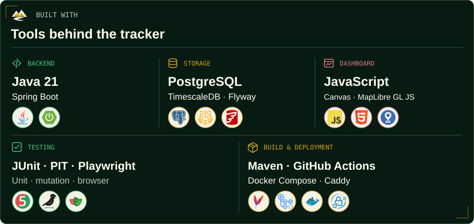

#  Colorado Traffic Tracker

[Open the dashboard](https://coloradotraffictracker.net/dashboard/) · [Why this project](https://coloradotraffictracker.net/dashboard/why.html) · [How it works](https://coloradotraffictracker.net/dashboard/system.html) · [About the data](https://coloradotraffictracker.net/dashboard/data.html) · [Engineering wiki](https://github.com/brentjColoS/ColoradoTrafficTracker/wiki)

Colorado Traffic Tracker combines speed charts, corridor maps and roadway
reports in a dashboard for Colorado's I-25 and I-70. It shows current conditions
along both routes.

Saved observations let visitors revisit earlier conditions, compare busy
periods and look for recurring slowdowns. A public API makes that history
available for further analysis.

The project is independently developed and maintained by [Brent Jackson](https://github.com/brentjColoS/ColoradoTrafficTracker/wiki/About-Me),
from data collection to deployment.

## The Stack

<a href="https://github.com/brentjColoS/ColoradoTrafficTracker/wiki/Local-Development">
  <picture>
    <source media="(max-width: 600px)" srcset="docs/assets/tech-stack-compact.svg">
    
  </picture>
</a>

The [development reference](https://github.com/brentjColoS/ColoradoTrafficTracker/wiki/Local-Development)
explains how these tools fit together.

## Tracked corridors

Coverage follows I-25 between Fort Collins and Denver, and I-70 between
Silverthorne and Denver. Moving markers trace the road geometry at a pace based
on estimated travel time.

<a href="https://coloradotraffictracker.net/dashboard/data.html#dataHeroMap">
  <picture>
    <source media="(max-width: 600px)" srcset="https://coloradotraffictracker.net/readme/current/map-compact.svg">
    
  </picture>
</a>

## Behind the dashboard

TomTom supplies observed traffic speeds, while the Colorado Department of
Transportation (CDOT) supplies incidents and planned events. Collection runs
independently of dashboard activity, with separate schedules so one unavailable
source does not interrupt the other.

Provider request limits are enforced before collection begins. The dashboard
and journal read saved observations, so exploring history does not increase
collection requests. The [engineering wiki](https://github.com/brentjColoS/ColoradoTrafficTracker/wiki/Architecture)
walks through the quota controls, storage decisions and API design.

## Traffic journal

The journal compares the latest 24 hours of corridor-average speeds with a
historical baseline from the preceding 13 completed weeks, matched by Denver
weekday and hour. The shaded band shows historical variation.

<a href="https://coloradotraffictracker.net/dashboard/">
  <picture>
    <source media="(max-width: 600px)" srcset="https://coloradotraffictracker.net/readme/current/journal-compact.svg">
    
  </picture>
</a>

The map estimates and journal refresh every 15 minutes. GitHub may cache older
images, so timestamps identify the displayed snapshot. The
[latest snapshot data (JSON)](https://coloradotraffictracker.net/readme/current/data.json)
includes the values and observation counts.

## Preserving the history

Older observations stay available as they move into archives. As of
November 21, 2026, the database held
[**531,796 corridor observations**](https://github.com/brentjColoS/ColoradoTrafficTracker/wiki/Historical-Storage)
across both routes.
[Automated tests](https://github.com/brentjColoS/ColoradoTrafficTracker/wiki/Testing-Strategy)
check historical access, while monitoring tracks new observations.

Coverage differs by dataset, and older I-70 averages describe a shorter stretch
of road. The [coverage notes](docs/data-history-coverage.md) document these limits.

The calendar summarizes the latest 60 completed Denver days and updates daily.
Each cell shows that day's lowest observed **corridor-average** speed, with
colors comparing days within the same corridor. Days without observations stay
uncolored.

<a href="https://coloradotraffictracker.net/dashboard/data.html">
  <picture>
    <source media="(max-width: 600px)" srcset="https://coloradotraffictracker.net/readme/current/calendar-compact.svg">
    
  </picture>
</a>

[Project journey](https://github.com/brentjColoS/ColoradoTrafficTracker/wiki/Project-Journey) · [About me](https://github.com/brentjColoS/ColoradoTrafficTracker/wiki/About-Me) · [API explorer](https://coloradotraffictracker.net/dashboard/api.html) · [CI results](https://github.com/brentjColoS/ColoradoTrafficTracker/actions/workflows/ci.yml)

Code is available under the [MIT license](LICENSE). Traffic data and map assets
retain their source terms; see [third-party notices](THIRD_PARTY_NOTICES.md).
