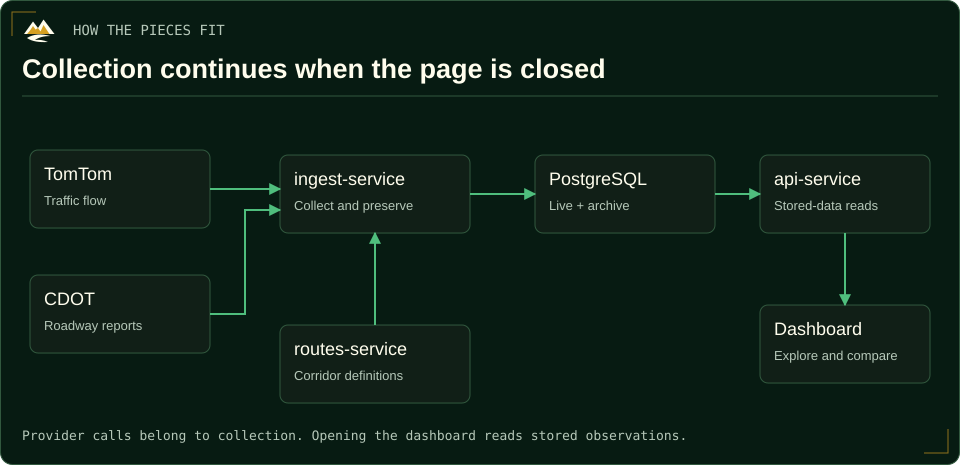

Collection, storage and presentation have separate responsibilities. The
collector writes observations on a schedule. The API serves retained data, and
the dashboard asks that API for the time window a visitor selects.

## Service boundaries

| Component | Owns |
| --- | --- |
| `routes-service` | Configured corridor bounds, road geometry and calibration anchors. |
| `ingest-service` | Provider reads, validation, request budgets, incident identity and retained observations. |
| PostgreSQL / TimescaleDB | Corridor samples, speed-zone history, durable incident events, map-cell read models and archives. |
| `api-service` | Current and historical queries, derived comparisons and the public dashboard assets. |
| Browser dashboard | Time selection, maps, charts, incident context and explanations of unavailable data. |

Opening the dashboard does not start a TomTom or CDOT poll. This boundary lets
visitors explore retained history without increasing collection requests.

## Decisions that matter to the data

**Request accounting is durable.** The collector reserves full batches against
separate account counters. Primary-first rollover preserves the selected flow
resolution. Recovery probes count as requests too.

**Retention preserves the read contract.** Older scalar samples move to archive
tables and remain available through archive-inclusive views. Speed-zone rows
are durable independently of the live parent table. Data missing before that
change is recorded as a coverage boundary.

**Incidents have their own identity.** Current incident maps and timelines use
durable provider-event records and transitions. New speed samples retain scalar
incident context; they do not duplicate the full incident payload on every poll.
Older compatibility records remain available for historical reads.

**Local maps are derived read models.** Current half-mile cells serve the latest
map. Hourly cell history supports historical views. A half-mile drawing interval
does not imply an independent sensor at every half mile or in both directions.

## The read boundary

The website uses the public, read-only `/dashboard-api/` surface. Protected
`/api/` endpoints retain their API-key boundary. Request limits, caches and
bounded historical queries sit on the API side; provider credentials stay in
collection configuration. The optional map configuration has its own restricted
browser-map key, which is separate from traffic-provider credentials.

The [window-summary contract](https://github.com/brentjColoS/ColoradoTrafficTracker/blob/main/docs/dashboard-window-summaries.md)
and [read-model notes](https://github.com/brentjColoS/ColoradoTrafficTracker/blob/main/docs/dashboard-read-models.md)
explain how larger historical windows are assembled without changing stored
observations.

## From source to a page

The [interactive System page](https://coloradotraffictracker.net/dashboard/system.html)
walks through a reading's path. For implementation details, start with
[ingestion](https://github.com/brentjColoS/ColoradoTrafficTracker/tree/main/ingest-service/src/main/java/com/example/ingest_service),
[API reads](https://github.com/brentjColoS/ColoradoTrafficTracker/tree/main/api-service/src/main/java/com/example/api_service)
or the [frontend ownership guide](https://github.com/brentjColoS/ColoradoTrafficTracker/blob/main/docs/frontend-maintainability.md).

[← Project journey](Project-Journey) · [Data and interpretation →](FAQ)
