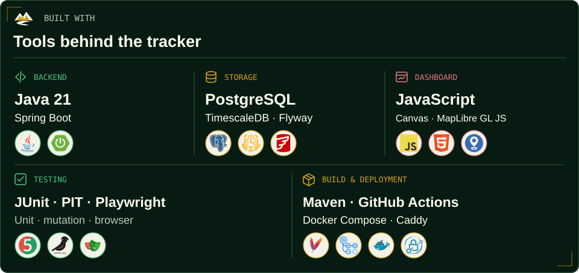

Collection and browsing have different workloads. Scheduled collectors spend
provider allowance to acquire observations; the API answers dashboard requests
from stored data. Changing a chart's time window therefore starts a database
read without triggering another TomTom or CDOT poll.

## Service boundaries

| Component | Responsibility |
| --- | --- |
| `routes-service` | Define corridor bounds, road geometry and mile-marker anchors. |
| `ingest-service` | Read providers, enforce request budgets and persist traffic and incident observations. |
| PostgreSQL / TimescaleDB | Retain observations, archive tables, incident identities, quota records and derived map data. |
| `api-service` | Query current and archived data, assemble comparisons and serve dashboard assets. |
| Browser dashboard | Request selected windows and display speed, map and incident context with availability labels. |

The services are separate Java applications, but their persistence contracts
share one database. Account counters are coordinated there; API caches and
in-flight request coordination are local to an API process. Those boundaries
matter when reasoning about concurrency or adding another instance.

## The Stack

<picture>
  <source media="(max-width: 600px)" srcset="https://raw.githubusercontent.com/brentjColoS/ColoradoTrafficTracker/main/docs/assets/tech-stack-compact.svg">
  
</picture>

The [development reference](Local-Development) explains each tool's role,
including the testing and operational tools behind these services.

## An observation's path

1. **Define coverage.** Corridor geometry determines which TomTom tiles to fetch
   and which CDOT events belong to the tracked roads.
2. **Reserve the work.** The collector deduplicates tile coverage and reserves a
   complete batch against one account. PostgreSQL conditionally increments the
   counter only if the batch fits.
3. **Persist observations.** Flow samples, detailed speed zones and source
   metadata support different query granularities. CDOT events use stable
   provider identities and lifecycle transitions on an independent schedule.
4. **Retain older data.** Bounded transactions move older corridor samples into
   archive tables. Shared views and logical sample references keep historical
   reads connected to them.
5. **Assemble a response.** The API selects original observations or derived
   summaries for the requested window. It coalesces matching work, limits cold
   calculations and reports unavailable stages separately.

The [System page](https://coloradotraffictracker.net/dashboard/system.html) gives
a visual version of this path. The walkthroughs below follow the actual write
and read contracts.

## Decisions and tradeoffs

| Decision | What it protects | Cost or boundary |
| --- | --- | --- |
| [Atomic, per-account reservations](Provider-Collection) before outbound requests | Concurrent collectors cannot grant more than the configured ledger limit. | A crash after reservation can conservatively leave allowance recorded as spent; there is no transaction spanning the database and provider. |
| [Transactional archive moves](Historical-Storage) behind a shared history view | Retention preserves queryable observations and logical sample identity. | Readers and joins must respect the live/archive identity contract. |
| [Durable incident identity](Historical-Storage) separate from flow samples | Repeated snapshots reuse events while preserving changes and transitions. | Legacy episodes still require reconstruction and a documented coverage boundary. |
| [Derived map read models](Historical-Storage) | Historical maps can read hourly cell summaries instead of rebuilding every original observation. | Hourly cells have different resolution and coverage from corridor samples. |
| [Single-flight caching and admission control](Dashboard-Reads) | Repeated selections share work; distinct cold queries cannot fan out without bounds. | Cold calculations may wait or return a busy result, and coordination is per process. |

## Failure boundaries

TomTom and CDOT run on separate schedules, so one failed source need not stop
the other. A malformed incident snapshot aborts its publication rather than
clearing events. On reads, an incident timeout can leave speed and travel
results available. [Dashboard reads](Dashboard-Reads) explains this failure
isolation and the separate clocks used for cache age and observation freshness.

Public, read-only `/dashboard-api/` routes serve the website. Separate `/api/`
routes retain API-key protection; provider credentials belong to collection
configuration. [API reference](API-Reference) covers request shapes and limits,
while [Testing and verification](Testing-Strategy) shows how these boundaries
are exercised.

The [frontend ownership guide](https://github.com/brentjColoS/ColoradoTrafficTracker/blob/main/docs/frontend-maintainability.md)
maps the browser modules and their responsibilities.

[← Wiki home](Home) · [Data and interpretation →](FAQ)
