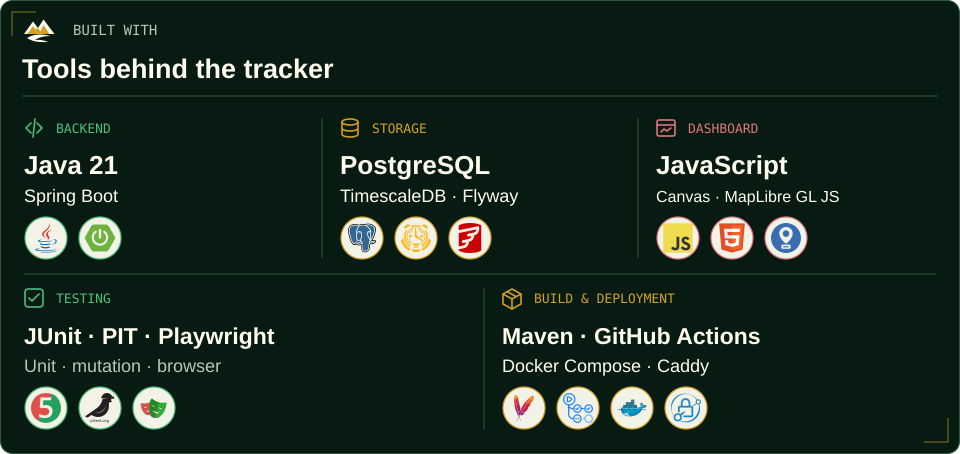

Colorado Traffic Tracker collects and retains traffic observations for Colorado's
I-25 and I-70. This wiki explains how collection, storage and API reads fit
together, with design decisions and tests linked to the implementation.

**[Open the dashboard](https://coloradotraffictracker.net/dashboard/)** to explore
current and historical conditions. The
[System page](https://coloradotraffictracker.net/dashboard/system.html) provides
a visual overview of the services behind it.

## The Stack

<picture>
  <source media="(max-width: 600px)" srcset="https://raw.githubusercontent.com/brentjColoS/ColoradoTrafficTracker/main/docs/assets/tech-stack-compact.svg">
  
</picture>

## Engineering guide

| Page | What it explains |
| --- | --- |
| [Architecture](Architecture) | Technology stack, service responsibilities and design tradeoffs. |
| [Data and interpretation](FAQ) | What speeds, travel estimates, calendar cells and gaps represent. |
| [Testing and verification](Testing-Strategy) | What the automated checks cover and how to inspect their results. |
| [Operations and reliability](Operations-Runbook) | How freshness, backups and deployed revisions are verified. |

## Design walkthroughs

Follow an observation from collection to a dashboard response, or start with the
problem that interests you:

| Design | Mechanism to inspect |
| --- | --- |
| [Provider collection](Provider-Collection) | Per-account budgets, atomic reservations, retries and refunds. |
| [Historical storage](Historical-Storage) | Archive identity, idempotent incident writes and data provenance. |
| [Dashboard reads](Dashboard-Reads) | Request coalescing, cache freshness, pagination and partial failures. |

The [storage walkthrough](Historical-Storage) includes a dated observation count.
[Testing and verification](Testing-Strategy) records a local ten-session browser
workload using synthetic history, with timing results, resource limits and the
tested revision.

## Reference

- **Data:** The [API explorer](https://coloradotraffictracker.net/dashboard/api.html)
  provides stored observations; [API reference](API-Reference) explains access,
  query limits and pagination.
- **Source:** The [repository](https://github.com/brentjColoS/ColoradoTrafficTracker)
  contains the implementation; [Development reference](Local-Development) maps
  the tools to their roles and links configuration and verification commands.

## Project and author

[Project journey](Project-Journey) follows the original traffic question and the
work it led to. [About me](About-Me) covers Brent Jackson's background,
development approach and other projects. [What's next](Roadmap) introduces the
planned winter snowplow layer and ideas for exploring the archive.

[Architecture →](Architecture)
